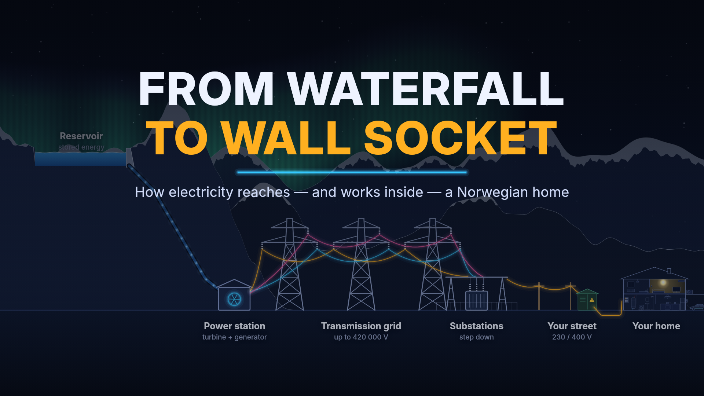

# From Waterfall to Wall Socket

An animated, narrated explainer (about 30 minutes, 1080p) on how electricity gets from a Norwegian
hydropower reservoir to the wall socket, with the main focus on what happens inside a Norwegian home.
It is written for a mechanical engineer: the basics are explained, with hydraulic and mechanical analogies,
and the depth then goes to trip curves, summation current transformers and IT/TN earthing systems.



* `out/from-waterfall-to-wall-socket-720p.mp4` – the video, 720p / 30 fps copy kept in the repository (English narration, soft subtitles, chapter markers)
* `out/from-waterfall-to-wall-socket.mp4` – the 1080p / 60 fps master. It is larger than GitHub's 100 MB file limit, so it is not committed; `tools/build.sh` regenerates it.
* `out/subtitles.en.srt` – subtitles
* `out/chapters.txt` – chapter time codes

## Chapters

1. The Basics – voltage, current, resistance as hydraulics; AC, RMS, power factor
2. Generation – Norwegian hydropower, P = η·ρ·g·Q·H, Pelton / Francis / Kaplan
3. The Generator – synchronous machine, three-phase, 230 V vs 400 V
4. Transmission – the transformer, why 420 kV, the three grid levels
5. Keeping the Balance – frequency, inertia, governors, HVDC links
6. The Last Transformer – the neighbourhood substation (nettstasjon)
7. The Norwegian Speciality – IT, TT and TN systems and what happens at an earth fault
8. Into the Home – service cable, main fuse, smart meter, earthing, the distribution board
9. The Circuit Breaker – bimetal, magnetic release, the arc chute, B and C curves
10. Earth Fault Protection – how an RCD (jordfeilbryter) works, types, surge and arc-fault protection, screw fuses
11. Circuits and Wiring – circuits in the house, cable heating and voltage drop, the Schuko socket
12. What Uses the Power – resistive heat, water heater, heat pump, induction, switching supplies, EV charging
13. A Day of Power – the daily load profile, capacity tariff, load shifting
14. Staying Safe – rules (NEK 400, DSB), warning signs, good habits
15. The Whole Journey – recap

## How it is made

Everything is code; there are no external assets.

* `src/lib/core.js` – small Canvas 2D animation toolkit (easing, glow strokes, flowing charges, plots)
* `src/lib/parts.js` – shared drawings (landscape, pylons, the cut-away house, UI helpers)
* `src/scenes/*.js` – one file per chapter. Each scene lists its narration lines; every line is a cue
  that the animation synchronises to (`s.in('cue', delay)`), so the picture follows the voice.
* `src/timeline.js`, `src/stage.js`, `src/render.js` – timeline, compositing and the render CLI
  (frames are drawn headless with `@napi-rs/canvas` and piped to `ffmpeg`)
* `tools/tts.py` – narration with the open Kokoro text-to-speech model, run locally
* `tools/asr_check.py` – proof-listens every narration line with a local Whisper model
* `tools/render_all.js`, `tools/build.sh` – parallel per-scene rendering and the final mux

### Rebuild

```bash
npm install
python3 -m venv tools/.venv && tools/.venv/bin/pip install kokoro-onnx soundfile numpy
# model files (about 350 MB) go in tools/models/:
#   https://github.com/thewh1teagle/kokoro-onnx/releases/download/model-files-v1.0/kokoro-v1.0.onnx
#   https://github.com/thewh1teagle/kokoro-onnx/releases/download/model-files-v1.0/voices-v1.0.bin
tools/build.sh 60 4        # fps, parallel workers
```

Useful while editing: `node src/render.js info`, `node src/render.js sheet <scene-id> 6 out.jpg`
(contact sheet of a scene), `node tools/smoke.js` (draws the whole timeline to catch errors).

## A note on the content

The video is an educational overview, not installation guidance. Figures are rounded and typical
(for example cable ratings depend on the installation method), and Norwegian rules change with each
edition of NEK 400. Work on a fixed installation must be done by a registered electrician.
